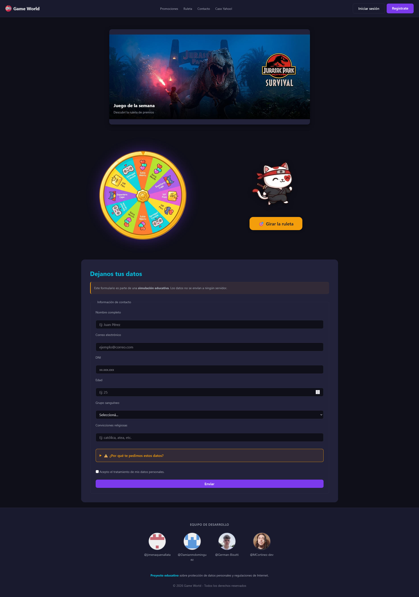
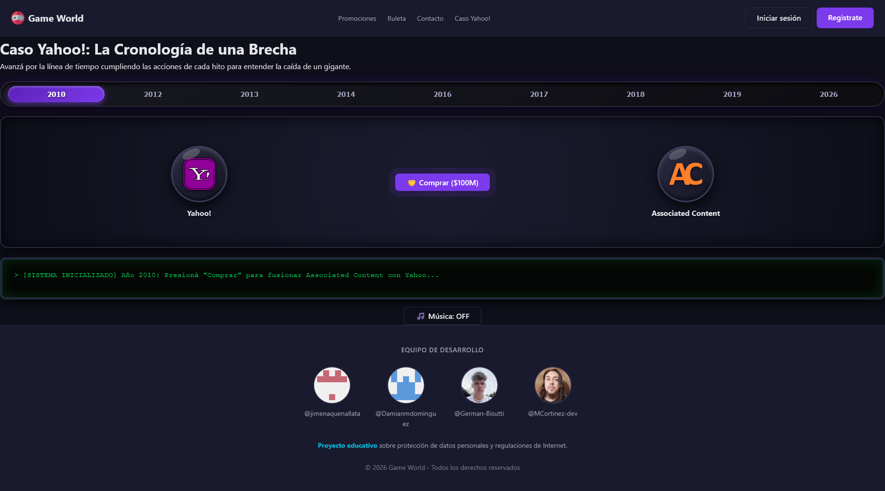

# 🎮 Game World | Plataforma Educativa Web & Leyes de Datos

> Proyecto académico interactivo desarrollado en **HTML5, CSS3 modular y JavaScript vainilla**, enfocado en la concientización sobre la privacidad en Internet, la seguridad informática y las normativas de protección de datos personales (con especial foco en la **Ley 25.326 de Argentina**).

[](https://gameworld-rouge.vercel.app/index.html)
[](LICENSE)
---

## 👥 Equipo de Desarrollo y Colaboradores

* **Docente a cargo:** *Hernán Cuñarro*
* **Jimena Quenallata** – [@jimenaquenallata](https://github.com/jimenaquenallata)
* **Damián Domínguez** – [@Damianmdominguez](https://github.com/Damianmdominguez)
* **Germán Bisutti** – [@German-Bisutti](https://github.com/German-Bisutti)
* **Matías Cortínez** – [@MCortinez-dev](https://github.com/MCortinez-dev)

---

## 🎯 ¿Qué es Game World?

**Game World** es una plataforma web didáctica simulada que combina el entretenimiento visual (minijuegos interactivos, ruleta de premios y carruseles) con casos de estudio reales sobre ciberseguridad y derecho informático. El objetivo principal es demostrar de forma lúdica cómo una mala gestión de bases de datos o la recolección excesiva de información personal vulnera los derechos de los usuarios.

### 🌟 Características Principales:
* **Cronología Interactiva del Caso Yahoo:** Un recorrido visual e interactivo (desde 2010 hasta 2026) que detalla la mayor brecha de datos de la historia, las consecuencias de los hashes MD5 débiles, inyecciones SQL, la venta a Verizon y las multas regulatorias de la SEC y la AAIP (Argentina).
* **Simulación de Recolección de Datos:** Formularios educativos que alertan sobre los peligros de solicitar datos sensibles (grupo sanguíneo, religión) sin cumplir con el principio de finalidad de la Ley 25.326.
* **Panel de Usuario y Minijuegos:** Área interactiva local con almacenamiento en `localStorage` y un minijuego de agilidad ("Atrapá al gato").

---

## 📂 Estructura del Proyecto

El proyecto está organizado de forma modular para facilitar el mantenimiento y el trabajo en equipo:

```text
WebVsLaws/
├── 📄 index.html              # Página principal (Home, carrusel y ruleta)
├── 📄 caso-yahoo.html         # Cronología interactiva del caso Yahoo
├── 📄 panel.html              # Panel de usuario local y minijuego
├── 📄 register.html           # Formulario de registro simulado
├── 📁 assets/                 # Recursos multimedia (imágenes, iconos, audios)
├── 📁 components/             # Partes reutilizables (header.html y footer.html)
├── 📁 css/                    # Hojas de estilo modulares por responsabilidades
└── 📁 js/                     # Scripts de la aplicación y carga de componentes
```

---

## 📸 Capturas de Pantalla

| Inicio (`index.html`) | Caso Yahoo! (`caso-yahoo.html`) |
| :---: | :---: |
|  |  |
	
## ⚖️ Marco Legal y Normativa Aplicada

El proyecto analiza y ejemplifica los artículos clave de la legislación vigente:

    Ley 25.326 de Protección de Datos Personales (Argentina): Tratamiento de datos sensibles (Art. 2 y 7), principio de finalidad y proporcionalidad (Art. 4), consentimiento informado (Art. 5 y 6), deber de seguridad (Art. 9) y derecho de supresión (Art. 16).

    AAIP (Agencia de Acceso a la Información Pública): Sanciones y precedentes sobre copias de seguridad deficientes.

    Jurisprudencia Internacional: Caso Google Spain (Derecho al olvido) y análisis financiero/legal del colapso operativo de Yahoo e incorporación a Altaba Inc.

---

## 🚀 Despliegue y Ejecución Local

1. Clonar el repositorio:
```Bash
git clone [https://github.com/MCortinez-dev/Web-vs-laws](https://github.com/MCortinez-dev/Web-vs-laws)
```
2. Abrir la carpeta del proyecto en tu editor de código (como VS Code).
3. Levantar un servidor local (por ejemplo, utilizando la extensión Live Server) para permitir la carga dinámica de los componentes de header.html y footer.html.